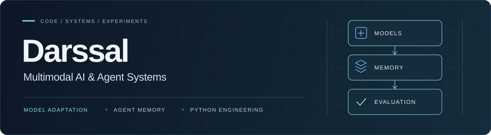

  

  <a href="https://github.com/Darssal/FracLogGPT-Lite">多模态项目</a> ·
  <a href="https://github.com/Darssal/Research-Code-Collection">研究代码合集</a> ·
  <a href="https://github.com/Darssal/FracLogGPT-Lite/blob/main/docs/QUICKSTART.md">无 GPU 快速验证</a>

关注多模态模型适配与 Python 实验工程。这里整理成像测井裂缝解释、招聘文本分类和多层 Agent 记忆实验的代码，提供源码、运行说明与离线测试入口。

## [FracLogGPT-Lite](https://github.com/Darssal/FracLogGPT-Lite)

以 Qwen 模型为基础，提供领域语料处理、LoRA-SFT、DPO / SimPO 实验配置与 Frac-VCD 视觉对比解码。训练调用 ms-swift，模型与 adapter 加载基于 Transformers / PEFT。

**技术栈：** Python · PyTorch · Transformers · PEFT / LoRA · ms-swift

### 从实现与测试了解项目

- **实验编排与阶段衔接**：从配置生成阶段命令、记录运行状态，解析 checkpoint 接续下游阶段。[编排实现](https://github.com/Darssal/FracLogGPT-Lite/blob/main/scripts/run_pipeline.py) · [checkpoint 解析](https://github.com/Darssal/FracLogGPT-Lite/blob/main/src/fraclog/checkpoints.py) · [测试](https://github.com/Darssal/FracLogGPT-Lite/blob/main/tests/test_run_pipeline.py)
- **推理中断恢复**：用稳定样本键跳过已完成预测，对结果去重，并通过输出文件锁避免并发覆盖。[实现](https://github.com/Darssal/FracLogGPT-Lite/blob/main/src/fraclog/predictions.py) · [测试](https://github.com/Darssal/FracLogGPT-Lite/blob/main/tests/test_predictions.py)
- **视觉对比解码**：同步处理原图与扰动图分支，融合下一 token 的 logits，提供同步解码与缓存路径。[实现](https://github.com/Darssal/FracLogGPT-Lite/blob/main/src/fraclog/vcd.py) · [测试](https://github.com/Darssal/FracLogGPT-Lite/blob/main/tests/test_vcd.py)

[数据处理](https://github.com/Darssal/FracLogGPT-Lite/blob/main/src/fraclog/data.py)负责 SFT / 偏好格式转换、图像引用检查和数据集划分；[评测模块](https://github.com/Darssal/FracLogGPT-Lite/blob/main/src/fraclog/metrics.py)解析参考与预测文本中的计数、位置和形态标签，计算文本标签一致性及过计数 / 欠计数等指标。

公共代码测试与阶段命令预演无需 GPU、模型权重或私有测井资料，步骤见[使用指南](https://github.com/Darssal/FracLogGPT-Lite/blob/main/docs/QUICKSTART.md)。

## [Research Code Collection](https://github.com/Darssal/Research-Code-Collection)

将其它研究代码整理为独立子工程，移除真实数据、凭据、论文材料和历史运行产物，并补充合成示例与提交检查。

| 子项目 | 实现重点 | 阅读入口 |
| --- | --- | --- |
| 招聘文本分类 | 中文字符 TF-IDF + 随机森林、可选 BERT、带超时与有界重试的外部服务适配 | [源码与运行说明](https://github.com/Darssal/Research-Code-Collection/tree/main/projects/job-text-classification) · [测试](https://github.com/Darssal/Research-Code-Collection/tree/main/projects/job-text-classification/tests) |
| 多层 Agent 记忆 | 上下文预算、缓存与持久化接口、检索注入策略、实验有效性检查 | [源码与运行说明](https://github.com/Darssal/Research-Code-Collection/tree/main/projects/memlab) · [测试](https://github.com/Darssal/Research-Code-Collection/tree/main/projects/memlab/tests) |

公开内容包含代码、配置、测试与合成示例；真实资料、权重和实验结果未公开。离线测试验证代码行为，完整训练、外部服务集成与模型效果需要另行配置和实际实验。
